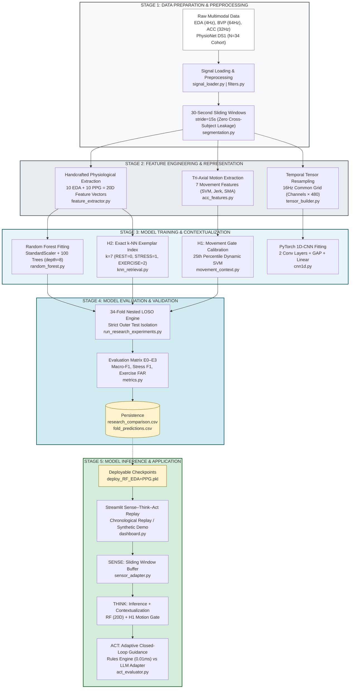
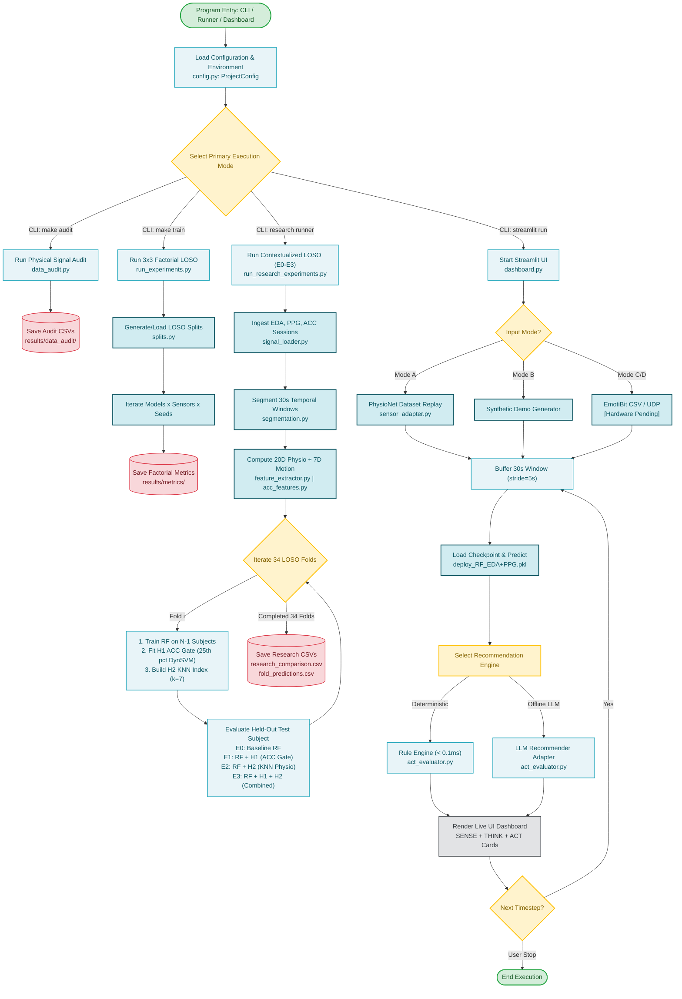

# Level 0: Complete System Overview

**COEN 6322: AI for Wearable Health Applications, Fall 2026**  
*Project: Stress vs. Exercise in Wrist Wearables: Does the Model Ranking Depend on the Sensor Set?*

---

## 1. Executive System Description

The system implements a standalone, reproducible machine learning pipeline designed to detect cognitive stress from non-invasive wearable sensors (Electrodermal Activity, Photoplethysmography, and Tri-Axial Accelerometry) while explicitly addressing the severe confounding effect of physical exercise.

The system is organized into **Five Main Engineering Stages**:

1. **Stage 1 — Data Preparation & Preprocessing:** Ingestion of raw physiological streams (EDA 4 Hz, BVP 64 Hz, ACC 32 Hz), zero-phase Butterworth filtering, and strict boundary-safe 30-second window segmentation.
2. **Stage 2 — Feature Engineering & Representation:** Domain-guided extraction of 20 physiological features (10 EDA, 10 PPG), 7 tri-axial motion intensity features, and multi-channel temporal tensor resampling (16 Hz, $C \times 480$).
3. **Stage 3 — Model Training & Contextualization:** Supervised training of Random Forest and 1D-CNN architectures, dynamic acceleration threshold calibration (H1), and non-parametric physiological $k$-NN reference-index construction (H2).
4. **Stage 4 — Model Evaluation & Validation:** Strict 34-fold nested Leave-One-Subject-Out (LOSO) cross-validation evaluating baseline (E0), ACC-aware (E1), similarity-aware (E2), and combined (E3) configurations across Stress F1, Macro-F1, and Exercise False Alarm Rate (FAR).
5. **Stage 5 — Model Inference & Application:** Streaming sensor adapter buffer, real-time model inference, deterministic sub-millisecond rule actuation vs. offline LLM recommendations, and an interactive Streamlit demonstrator.

---

## 2. Macro Block Diagram (Level 0)

---

## 3. Macro Execution Flowchart (Level 0)

---

## 4. Stage Summary & File Reference Table

| Stage | Name | Key Modules | Primary Functions / Classes | Inputs | Outputs |
|---|---|---|---|---|---|
| **1** | **Data Preparation** | `src/preprocessing/signal_loader.py` `src/preprocessing/segmentation.py` `src/preprocessing/filters.py` `src/data_audit.py` | `SignalLoader` `WindowSegmenter` `filter_eda()`, `filter_bvp()` | Raw Empatica CSVs (`EDA.csv`, `BVP.csv`, `ACC.csv`, `tags.csv`) | 30s Window Dicts (`eda_window`, `bvp_window`, `acc_window`, `label`) |
| **2** | **Feature Engineering** | `src/features/feature_extractor.py` `src/research/acc_aware/acc_features.py` `src/models/tensor_builder.py` | `FeatureExtractor` `extract_acc_features()` `TensorBuilder` | 30s Window Dicts | 20D Physio Vectors, 7D ACC Vectors, $(C \times 480)$ Tensors |
| **3** | **Model Training** | `src/models/random_forest.py` `src/models/cnn1d.py` `src/research/acc_aware/movement_context.py` `src/research/similarity_aware/knn_retrieval.py` `src/research/fusion/fusion_policy.py` | `RandomForestClassifier` `Small1DCNN`, `CNNTrainer` `MovementContextualizer` `PhysiologicalKNN` `FusionPolicy` | Training Matrices ($X_{\text{train}}, y_{\text{train}}$), Exercise Windows | Trained Classifiers, Gate Thresholds, Fitted $k$-NN Index |
| **4** | **Model Evaluation** | `src/evaluation/splits.py` `src/evaluation/metrics.py` `src/experiments/run_experiments.py` `src/research/run_research_experiments.py` | `generate_loso_manifest()` `compute_binary_metrics()` `compute_exercise_far()` `run_research_experiments()` | Outer Folds Manifest, Precomputed Features | `factorial_metrics.csv`, `research_comparison.csv`, `fold_predictions.csv` |
| **5** | **Model Inference** | `src/act/sensor_adapter.py` `src/act/dashboard.py` `src/act/act_evaluator.py` `src/act/run_act_eval.py` | `ReplaySensorAdapter` `Streamlit UI` `DeterministicRuleAct` `LLMActAdapter` | Live stream / Replay buffer, Checkpoints | Stress predictions, Rule action codes, LLM advice, Session logs |

---

## 5. Navigation Links

- [Level 4: Python Code Execution Map & Call Graphs](python_execution_map.md)
- [Stage 1: Data Preparation & Preprocessing](../01-data-preparation/README.md)
- [Stage 2: Feature Engineering & Representation](../02-feature-engineering/README.md)
- [Stage 3: Model Training & Contextualization](../03-model-training/README.md)
- [Stage 4: Model Evaluation & Validation](../04-model-evaluation/README.md)
- [Stage 5: Model Inference & Application](../05-model-inference/README.md)
- [Subsystems Architecture Deep Dives](../subsystems/README.md)
- [Vector Data Cloud Visualization](../visualizations/README.md)
