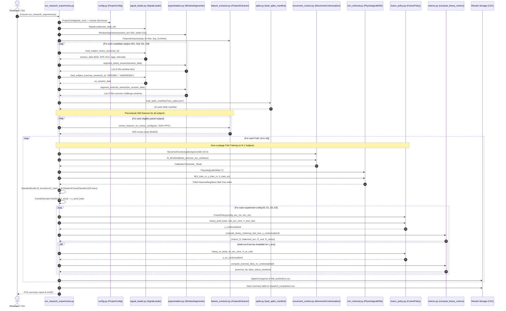

# Level 4: Python Code Execution Map & Call Graphs

**COEN 6322: AI for Wearable Health Applications, Fall 2026**

This document maps the exact Python execution flow, module dependencies, function invocation sequences, data transfers, and persistence destinations across the **Four Primary Entry Points** of the codebase:

1. **Workflow A:** Research Contextualization Evaluation (`src/research/run_research_experiments.py`)
2. **Workflow B:** Baseline 3×3 Factorial Benchmark (`src/experiments/run_experiments.py`)
3. **Workflow C:** Streamlit Sense–Think–Act Dashboard (`src/act/dashboard.py`)
4. **Workflow D:** Automated Test Suite (`tests/test_pipeline.py` & `tests/test_research.py`)

---

## Workflow A: Research Contextualization Engine

### Command Entry Point
```bash
python3 -m src.research.run_research_experiments [--data-dir PATH]
```

### Execution Map & Function Call Hierarchy


---

## Workflow B: Baseline 3×3 Factorial Engine

### Command Entry Point
```bash
python3 src/experiments/run_experiments.py
# or: make train
```

### Module Execution Order
1. **`src/config.py`:** Initializes default configuration paths.
2. **`src/preprocessing/signal_loader.py`:** Ingests raw stress & exercise sessions across 34 eligible subjects.
3. **`src/preprocessing/segmentation.py`:** Slices 30-second windows ($50\%$ overlap).
4. **`src/features/feature_extractor.py`:** Extracts 10 EDA, 10 PPG, and 20 fused features.
5. **`src/models/tensor_builder.py`:** Resamples waveforms to 16 Hz for 1D-CNN ($C \times 480$).
6. **`src/evaluation/splits.py`:** Generates outer LOSO folds and deterministic inner validation sets (20% ratio).
7. **Nested Iteration Loop:**
   - Evaluates **3 Models** (`Majority`, `RandomForest`, `1D-CNN`) $\times$ **3 Sensor Sets** (`EDA`, `PPG`, `EDA+PPG`) $\times$ **3 Random Seeds** (`42`, `123`, `999`).
   - Standardizes tabular features per fold (`StandardScaler`) or normalizes waveform channels (`train_mean`, `train_std`).
8. **`src/evaluation/metrics.py`:** Computes pooled metrics, subject-clustered bootstrap 95% CIs, and exercise false alarm rates.
9. **`src/models/random_forest.py` & `src/models/cnn1d.py`:** Fits final deployment models on all 34 subjects and serializes checkpoints (`data/results/checkpoints/deploy_*.pkl`, `deploy_*.pt`).
10. **Persistence:** Writes `factorial_metrics.csv`, `subject_level_metrics.csv`, `exercise_far_metrics.csv`, and `interaction_analysis.json`.

---

## Workflow C: Streamlit Sense–Think–Act Dashboard

### Command Entry Point
```bash
streamlit run src/act/dashboard.py
# or: make run-dashboard
```

### Module Execution Order
1. **`src/act/dashboard.py` (Script Entry):**
   - Configures Streamlit page (`st.set_page_config(layout="wide")`).
   - Initializes cached resources via `@st.cache_resource`: `get_loader()`, `get_feature_extractor()`, `get_tensor_builder()`.
2. **User Input Selection (Sidebar):**
   - Mode Selection: Mode A (PhysioNet Replay), Mode B (Synthetic Demo), Mode C/D (EmotiBit).
   - Subject (`S01`..`f18`), Session (`STRESS`, `AEROBIC`, `ANAEROBIC`), Model architecture, Sensor configuration, and stride seconds.
3. **`src/act/sensor_adapter.py` (`ReplaySensorAdapter`):**
   - Stores incoming stream in a circular buffer with time indexing.
   - Pushes samples and prunes old data beyond `current_time - 60s`.
   - Extracts current 30-second window slice: `adapter.get_latest_window()`.
4. **Column 1 — SENSE:**
   - Plots interactive biometric waveforms for EDA ($\mu\text{S}$) and BVP (raw pulse).
5. **Column 2 — THINK:**
   - Extracts 20D feature vector via `FeatureExtractor`.
   - Loads deployment checkpoint `deploy_RF_EDA+PPG.pkl`.
   - Executes model inference: `rf_deploy.predict_proba(scaler.transform(X))`.
   - Renders visual gauge of stress probability and predicted label.
6. **Column 3 — ACT:**
   - Constructs structured state context dictionary.
   - Evaluates `src/act/act_evaluator.py`:
     - Calls `DeterministicRuleAct.generate_recommendation(context)` ($< 0.1\,\text{ms}$).
     - Calls `LLMActAdapter.generate_recommendation(context)` (offline natural language advice).
   - Renders recommendation cards and latency/cost telemetry.
7. **Session Logging:**
   - Optional button triggers JSON serialization to `llm_logs/replay_session_log.json`.
8. **Research Panel:**
   - Collapsible expander loads `data/results/research/comparison/research_comparison.csv` and renders live empirical comparison metrics.

---

## Workflow D: Automated Test Suite

### Command Entry Point
```bash
python3 -m unittest discover tests -v
# or: make test
```

### Test Call Hierarchy
```text
tests/
├── test_pipeline.py (TestWearablePipelineComprehensive)
│   ├── test_01_filter_stability_and_shapes()      -> calls filters.filter_eda(), filter_bvp()
│   ├── test_02_segmentation_boundaries_and_labels() -> calls segmentation.WindowSegmenter()
│   ├── test_03_feature_extractor_dimensions()    -> calls feature_extractor.FeatureExtractor()
│   ├── test_04_tensor_builder_shapes()            -> calls tensor_builder.TensorBuilder()
│   ├── test_05_1d_cnn_architecture_forward_pass() -> calls cnn1d.Small1DCNN()
│   ├── test_06_loso_zero_leakage_assertion()      -> calls splits.generate_loso_manifest()
│   ├── test_07_baseline_classifier_behavior()    -> calls baseline.MajorityBaselineClassifier()
│   ├── test_08_checkpoint_loading_and_inference()-> loads deploy_RF_EDA+PPG.pkl
│   ├── test_09_metrics_and_far_calculation()      -> calls metrics.compute_binary_metrics(), compute_exercise_far()
│   └── test_10_deterministic_act_recommendation()-> calls act_evaluator.DeterministicRuleAct()
│
├── test_preprocessing.py (TestWearablePipeline)
│   └── (Regression checks on filter shapes, tensor sizes, and boundary windowing)
│
└── test_research.py (10 Tests: Research Contextualization Suite)
    ├── TestAccFeatures:
    │   ├── test_output_shape_and_dtype()          -> calls acc_features.extract_acc_features()
    │   ├── test_feature_names_length()            -> verifies 7 feature constants
    │   ├── test_dynamic_svm_higher_for_exercise() -> verifies kinematic dynamic SVM response
    │   └── test_empty_input_returns_zeros()       -> verifies defensive zero handling
    ├── TestMovementContextualizer:
    │   ├── test_exercise_flagged_as_high_movement()-> verifies is_high_movement() gate
    │   └── test_stress_suppressed_for_exercise()  -> verifies STRESS -> REST contextualization
    ├── TestPhysiologicalKNN:
    │   └── test_vote_fractions_sum_to_one()       -> verifies exact k-NN probability sum
    ├── TestSimilarityContextualizer:
    │   └── test_stress_suppressed_near_exercise() -> verifies k-NN neighbor vote gating
    └── TestFusionPolicy:
        ├── test_e0_is_passthrough()               -> verifies baseline unchanged output
        └── test_all_configs_produce_valid_binary()-> verifies E0-E3 validity across batches
```
