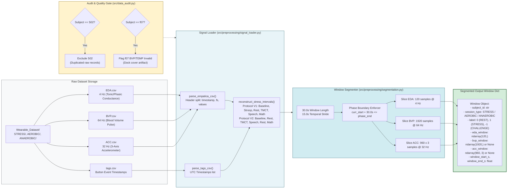

# Stage 1: Data Preparation & Preprocessing

**COEN 6322: AI for Wearable Health Applications, Fall 2026**

---

## 1. Stage Scope & Responsibilities

Stage 1 handles raw biometric file discovery, header parsing, timestamp reconstruction, subject qualification/exclusions, signal filtering, and temporal window segmentation. It guarantees zero data leakage across participant boundaries and protocol phases.

### Primary Modules
- [`src/preprocessing/signal_loader.py`](file:///Users/fernando/Concordia/2026_2_Fall/COEN_6322/project/code/src/preprocessing/signal_loader.py): `SignalLoader` class for parsing Empatica E4 CSV exports and reconstructing ground-truth stress intervals.
- [`src/preprocessing/segmentation.py`](file:///Users/fernando/Concordia/2026_2_Fall/COEN_6322/project/code/src/preprocessing/segmentation.py): `WindowSegmenter` class creating 30-second temporal windows with 15-second stride.
- [`src/preprocessing/filters.py`](file:///Users/fernando/Concordia/2026_2_Fall/COEN_6322/project/code/src/preprocessing/filters.py): Zero-phase Butterworth lowpass and bandpass digital filtering.
- [`src/data_audit.py`](file:///Users/fernando/Concordia/2026_2_Fall/COEN_6322/project/code/src/data_audit.py): Signal verification, sampling frequency checks, and cohort sanity reporting.

---

## 2. Ingested Sensor Streams & Specifications

| Signal Modality | File Name | Sampling Rate ($f_s$) | Physical Units | Samples per 30s Window | Filtering / Conditioning |
|---|---|---|---|---|---|
| **Electrodermal Activity (EDA)** | `EDA.csv` | 4.0 Hz | Micro-Siemens ($\mu\text{S}$) | 120 | 4th-order Butterworth low-pass ($f_c = 1.0\text{ Hz}$); tonic/phasic separation |
| **Photoplethysmography (BVP)** | `BVP.csv` | 64.0 Hz | Relative pulse amplitude | 1920 | 4th-order Butterworth bandpass ($0.5 - 8.0\text{ Hz}$) |
| **Tri-Axial Accelerometry (ACC)**| `ACC.csv` | 32.0 Hz | Empatica integer units ($\sim 64 \approx 1g$) | $960 \times 3$ (2880) | 1-second rolling gravity removal ($32\text{ samples}$) |
| **Event Markers (Tags)** | `tags.csv` | Aperiodic | UTC Timestamp | Variable | Protocol interval boundary alignment |

---

## 3. Cohort Rules, Exclusions & Aliases

The PhysioNet DS1 repository consists of 36 candidate subject directories (`S01`–`S18` and `f01`–`f18`). The audit gate applies documented scientific rules:

1. **Subject `S02` Excluded:** Contains duplicated and misaligned row records in raw CSV files. Permanently excluded from evaluation.
2. **Subject `f07` Excluded from Paired Cohort:** BVP/PPG sensor port was obstructed by an Empatica dock cover during recording. EDA is valid, but subject is excluded from multimodal paired evaluation ($N=34$ paired cohort).
3. **Folder Aliases Handled:**
   - Stress session for `f14` is read from `Wearable_Dataset/STRESS/f14_b/` (the main protocol execution).
   - Aerobic exercise for `S11` is read from `Wearable_Dataset/AEROBIC/S11_a/`.
   - Anaerobic exercise for `S16` is read from `Wearable_Dataset/ANAEROBIC/S16_a/`.

---

## 4. Stage 1 Block Diagram

---

## 5. Stage 1 Execution Flowchart

```mermaid
flowchart TD
    START(["Start: load_subject_stress_session(subject_id)"]):::terminator --> CHECK_ID{"subject_id == 'S02'?"}:::decision

    CHECK_ID -->|"Yes (Known Corrupt)"| RET_NONE["Return None (Exclude S02)"]:::output
    CHECK_ID -->|"No"| FOLDER_RES{"subject_id == 'f14'?"}:::decision

    FOLDER_RES -->|"Yes"| USE_F14B["Folder path: STRESS/f14_b/"]:::process
    FOLDER_RES -->|"No"| USE_NORMAL["Folder path: STRESS/{subject_id}/"]:::process

    USE_F14B & USE_NORMAL --> READ_CSVS["Read CSV files via parse_empatica_csv():<br/>1. EDA.csv<br/>2. BVP.csv<br/>3. ACC.csv<br/>4. tags.csv"]:::subproc

    READ_CSVS --> PARSE_HDR["Parse Header Lines:<br/>Line 0: start_timestamp (split comma, UTC)<br/>Line 1: sampling_frequency (split comma)<br/>Line 2+: Signal numeric rows"]:::process

    PARSE_HDR --> VALID_CHECK{"EDA valid?<br/>(eda_dt != None and eda_fs > 0 and len > 0)"}:::decision
    VALID_CHECK -->|"No"| RET_NONE
    VALID_CHECK -->|"Yes"| CHECK_F07{"subject_id == 'f07'?"}:::decision

    CHECK_F07 -->|"Yes (Dock Covered)"| SET_BVP_INVALID["bvp_valid = False<br/>bvp_signal = empty"]:::process
    CHECK_F07 -->|"No"| SET_BVP_VALID["bvp_valid = (bvp_fs > 0 and len > 0)"]:::process

    SET_BVP_INVALID & SET_BVP_VALID --> ACC_CHECK["acc_valid = (acc_fs > 0 and acc_sig.ndim == 2 and shape[1] == 3)"]:::process

    ACC_CHECK --> RECON_LABELS["Reconstruct Stress Intervals:<br/>reconstruct_stress_intervals(start_time, tags, is_v1)"]:::subproc

    RECON_LABELS --> INT_DEC{"Protocol Tag Structure Match?"}:::decision
    INT_DEC -->|"V1 and len(tags) >= 12"| TAGS_V1["Map Tags: Baseline, Stroop, FirstRest,<br/>TMCT, SecondRest, RealOp, OppOp, Subtract"]:::process
    INT_DEC -->|"V2 and len(tags) >= 8"| TAGS_V2["Map Tags: Baseline, TMCT, FirstRest,<br/>RealOp, OppOp, SecondRest, Subtract"]:::process
    INT_DEC -->|"Incomplete Tags"| NOMINAL_FB["Nominal Protocol Duration Fallback"]:::process

    TAGS_V1 & TAGS_V2 & NOMINAL_FB --> ASSEMBLE_SESS["Assemble Session Dict"]:::process

    ASSEMBLE_SESS --> SEG_ENTRY(["Enter segment_stress_session(session_data)"]):::terminator
    SEG_ENTRY --> LOOP_INT{"For each interval in labeled_intervals"}:::decision

    LOOP_INT -->|"Interval done"| INT_CHECK{"Interval duration >= 30.0s?"}:::decision
    INT_CHECK -->|"No"| NEXT_INT["Skip short interval"]:::process
    INT_CHECK -->|"Yes"| INIT_WIN["curr_start = interval.start_s"]:::process

    INIT_WIN --> WIN_LOOP{"curr_start + 30.0s <= interval.end_s?"}:::decision
    WIN_LOOP -->|"No"| LOOP_INT
    WIN_LOOP -->|"Yes"| SLICE_SIGNALS["Slice window from signals:<br/>eda_idx: round(curr_start*4) to round(curr_end*4)<br/>bvp_idx: round(curr_start*64) to round(curr_end*64)<br/>acc_idx: round(curr_start*32) to round(curr_end*32)"]:::process

    SLICE_SIGNALS --> APPEND_WIN["Append window dict to windows list:<br/>{subject_id, phase, label, eda_window, bvp_window, acc_window, window_start_s, window_end_s}"]:::process
    APPEND_WIN --> STEP_STRIDE["curr_start += stride_s (15.0s)"]:::process
    STEP_STRIDE --> WIN_LOOP

    LOOP_INT -->|"All intervals processed"| RET_WINS(["Return list of 30s Window Dicts"]):::terminator

    classDef terminator fill:#d4edda,stroke:#28a745,stroke-width:2px,color:#155724;
    classDef process fill:#e8f4f8,stroke:#17a2b8,stroke-width:1.5px,color:#0c5460;
    classDef subproc fill:#d1ecf1,stroke:#0c5460,stroke-width:2px,color:#0c5460;
    classDef decision fill:#fff3cd,stroke:#ffc107,stroke-width:2px,color:#856404;
    classDef output fill:#e2e3e5,stroke:#383d41,stroke-width:1.5px,color:#383d41;
```

