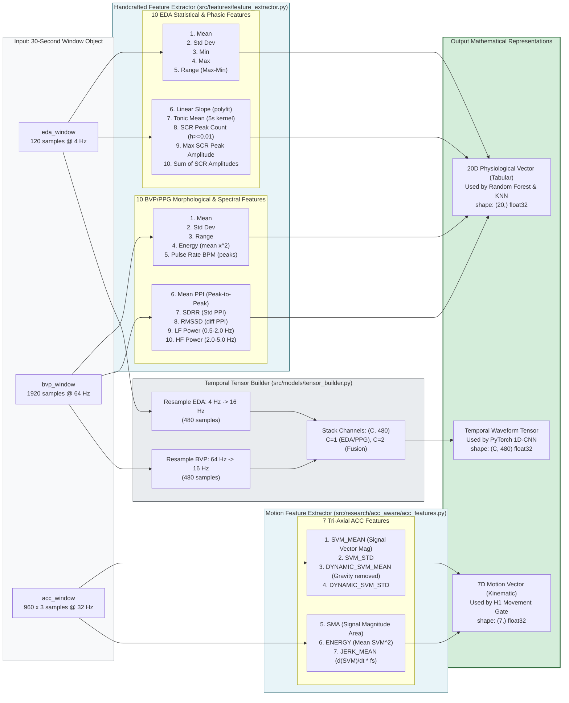
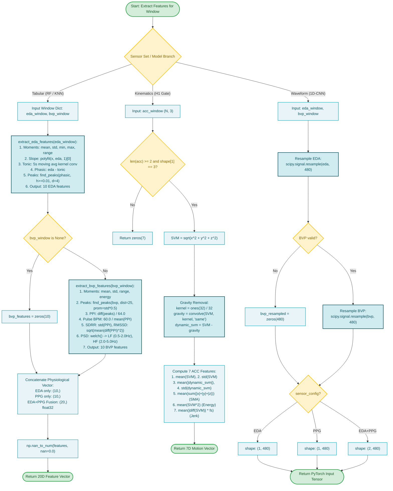

# Stage 2: Feature Engineering & Representation

**COEN 6322: AI for Wearable Health Applications, Fall 2026**

---

## 1. Stage Scope & Responsibilities

Stage 2 transforms raw continuous 30-second physiological and kinematic window arrays into standardized numerical representations appropriate for downstream machine learning models:
1. **20-Dimensional Handcrafted Physiological Features:** Engineered for tabular Random Forest classification and non-parametric $k$-NN exemplar retrieval.
2. **7-Dimensional Kinematic Motion Features:** Derived from 3-axis accelerometry to measure dynamic physical exertion for H1 movement gating.
3. **Temporal Waveform Tensors ($(C \times 480)$):** Resampled to a uniform 16 Hz temporal grid for end-to-end 1D Convolutional Neural Network training.

---

## 2. 20-Dimensional Physiological Feature Set

Implemented in [`src/features/feature_extractor.py`](file:///Users/fernando/Concordia/2026_2_Fall/COEN_6322/project/code/src/features/feature_extractor.py) (`FeatureExtractor`).

### EDA Sub-Vector (Features 1 to 10)
| Index | Feature Name | Description | Mathematical Formulation |
|---|---|---|---|
| **0** | `EDA_MEAN` | Arithmetic mean of window | $\mu = \frac{1}{N} \sum_{i=1}^N x_i$ |
| **1** | `EDA_STD` | Standard deviation | $\sigma = \sqrt{\frac{1}{N} \sum (x_i - \mu)^2}$ |
| **2** | `EDA_MIN` | Minimum skin conductance value | $\min(x)$ |
| **3** | `EDA_MAX` | Peak skin conductance value | $\max(x)$ |
| **4** | `EDA_RANGE` | Conductance span | $\max(x) - \min(x)$ |
| **5** | `EDA_SLOPE` | Linear drift rate | First-order polynomial coefficient $\beta_1$ via `np.polyfit(t, x, 1)` |
| **6** | `EDA_TONIC_MEAN` | Mean of tonic component (SCL) | Moving average filter (5-second kernel, 20 samples) |
| **7** | `EDA_SCR_NUM_PEAKS` | Phasic peak count (SCR) | Peaks detected on phasic signal with height $\ge 0.01\,\mu\text{S}$, distance $\ge 1.0\,\text{s}$ |
| **8** | `EDA_SCR_MAX_AMP` | Maximum SCR peak amplitude | $\max(\text{peak\_heights})$ |
| **9** | `EDA_SCR_SUM_AMP` | Cumulative phasic amplitude | $\sum \text{peak\_heights}$ |

### BVP/PPG Sub-Vector (Features 11 to 20)
| Index | Feature Name | Description | Mathematical Formulation |
|---|---|---|---|
| **10** | `BVP_MEAN` | Arithmetic mean | $\mu = \frac{1}{N} \sum y_i$ |
| **11** | `BVP_STD` | Signal dispersion | $\sigma = \sqrt{\frac{1}{N} \sum (y_i - \mu)^2}$ |
| **12** | `BVP_RANGE` | Pulse excursion | $\text{ptp}(y) = \max(y) - \min(y)$ |
| **13** | `BVP_ENERGY` | Mean signal energy | $\frac{1}{N} \sum y_i^2$ |
| **14** | `BVP_PULSE_RATE_BPM` | Estimated instantaneous pulse | Systolic peaks detected with distance $\ge 0.4\,\text{s}$ ($150\,\text{BPM}$ max); $\text{BPM} = 60 / \overline{\text{PPI}}$ |
| **15** | `BVP_MEAN_PPI` | Mean peak-to-peak interval | $\overline{\text{PPI}} = \frac{1}{K} \sum \Delta t_{\text{peaks}}$ (seconds) |
| **16** | `BVP_SDRR` | Standard deviation of intervals | $\sigma_{\text{PPI}}$ (Heart Rate Variability measure) |
| **17** | `BVP_RMSSD` | Root mean square successive diffs | $\sqrt{\frac{1}{K-1} \sum (\text{PPI}_{k+1} - \text{PPI}_k)^2}$ |
| **18** | `BVP_LF_POWER` | Low-frequency spectral power | Spectral density in $0.5 - 2.0\,\text{Hz}$ via Welch periodogram |
| **19** | `BVP_HF_POWER` | High-frequency spectral power | Spectral density in $2.0 - 5.0\,\text{Hz}$ via Welch periodogram |

---

## 3. 7-Dimensional Tri-Axial ACC Motion Feature Set

Implemented in [`src/research/acc_aware/acc_features.py`](file:///Users/fernando/Concordia/2026_2_Fall/COEN_6322/project/code/src/research/acc_aware/acc_features.py) (`extract_acc_features`).

From a 30-second window at 32 Hz ($960 \times 3$ integer acceleration values in Empatica units where $\sim 64 \approx 1g$):

1. **`SVM_MEAN`:** Mean Signal Vector Magnitude ($SVM = \sqrt{x^2 + y^2 + z^2}$).
2. **`SVM_STD`:** Standard deviation of total acceleration magnitude.
3. **`DYNAMIC_SVM_MEAN`:** Dynamic motion intensity isolated by subtracting a 1-second (32-sample) moving average gravity estimate: $\text{Dynamic } SVM = SVM - \text{Convolve}(SVM, \mathbf{1}_{32}/32)$.
4. **`DYNAMIC_SVM_STD`:** Variability of dynamic acceleration.
5. **`SMA`:** Signal Magnitude Area: $\frac{1}{N} \sum (|x| + |y| + |z|)$.
6. **`ENERGY`:** Mean squared magnitude: $\frac{1}{N} \sum SVM^2$.
7. **`JERK_MEAN`:** Rate of change of acceleration magnitude: $\frac{1}{N-1} \sum |\Delta SVM| \times f_s$.

---

## 4. Stage 2 Block Diagram

---

## 5. Stage 2 Execution Flowchart

