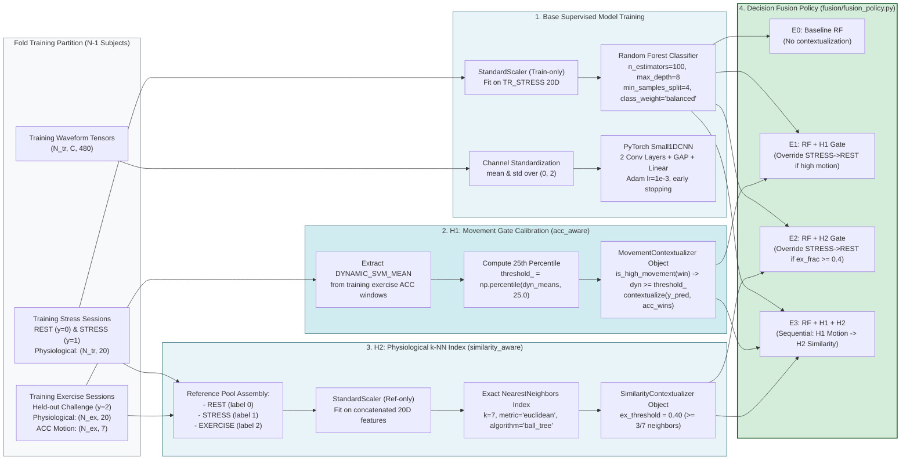
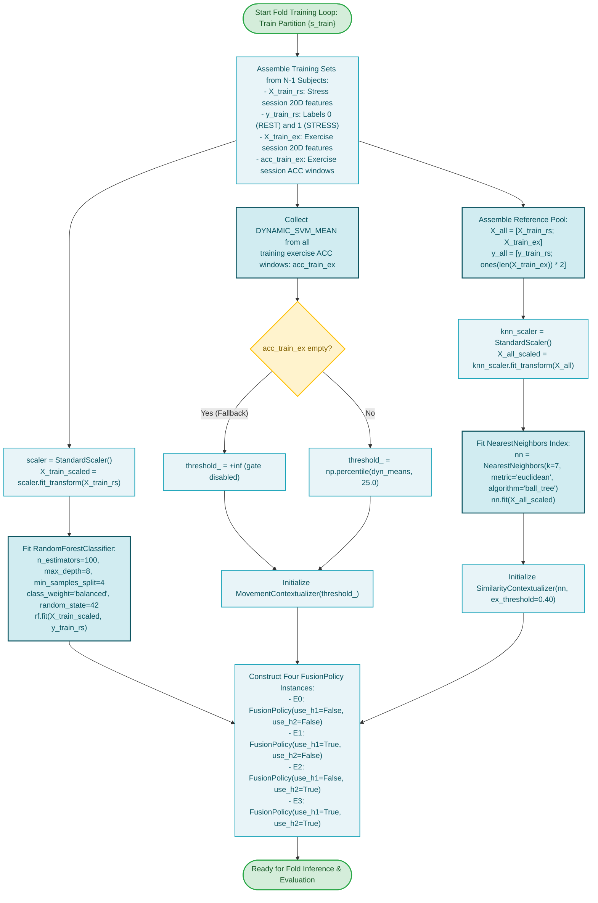

# Stage 3: Model Training & Contextualization

**COEN 6322: AI for Wearable Health Applications, Fall 2026**

---

## 1. Stage Scope & Responsibilities

Stage 3 coordinates the model fitting and contextualization layer setup strictly on the $N-1$ development subjects within each cross-validation fold. It guarantees strict zero-leakage boundaries by distinguishing three distinct training procedures:
1. **Supervised Classifier Fitting:** Standardized Random Forest and PyTorch 1D-CNN trained on labeled stress protocol data (REST vs. STRESS).
2. **Kinematic Threshold Calibration (H1):** Non-parametric calibration of the dynamic acceleration gate fitted strictly on training exercise sessions.
3. **Exemplar Indexing (H2):** Construction of a 3-class ($k=7$) exact spatial ball-tree index over training physiological features including exercise exemplars.
4. **Policy Formulation:** Assembling the decision fusion policies for configurations E0, E1, E2, and E3.

---

## 2. Model Architectures & Calibration Parameters

### Primary Classifiers
- **Random Forest (`src/models/random_forest.py`):**
  - Architecture: Scikit-learn ensemble of 100 decision trees.
  - Regularization: `max_depth=8`, `min_samples_split=4`.
  - Class Balancing: `class_weight='balanced'` to offset natural class imbalance (REST ~80%, STRESS ~20%).
  - Preprocessing: `StandardScaler` fitted strictly on training fold matrices.
- **1D-CNN (`src/models/cnn1d.py`):**
  - Architecture: `Conv1D(in_channels, 16, k=7, s=2, p=3) -> ReLU -> Conv1D(16, 32, k=5, s=2, p=2) -> ReLU -> GlobalAveragePooling1D -> Linear(32, 2)`.
  - Optimization: Adam ($\text{lr} = 10^{-3}$, batch size 64). Early stopping with patience 2 on inner validation set.

### H1 Movement Gate Calibration (`src/research/acc_aware/movement_context.py`)
- **Metric:** `DYNAMIC_SVM_MEAN` (mean of gravity-subtracted signal vector magnitude).
- **Calibration Set:** All valid ACC windows from training subjects' AEROBIC and ANAEROBIC sessions.
- **Decision Boundary:** 25th percentile of dynamic acceleration:
  $$\tau_{\text{motion}} = \text{Percentile}_{25}(\{\text{DYNAMIC\_SVM\_MEAN}_i\}_{i \in \text{TrainExercise}})$$
- **Logic:** Any test window classified as STRESS (1) whose `DYNAMIC_SVM_MEAN` $\ge \tau_{\text{motion}}$ is overridden to REST (0).

### H2 Similarity Index Construction (`src/research/similarity_aware/knn_retrieval.py`)
- **Algorithm:** Scikit-learn `NearestNeighbors(n_neighbors=7, metric='euclidean', algorithm='ball_tree')`.
- **Reference Pool:**
  - REST ($y=0$): All training stress session baseline and recovery windows.
  - STRESS ($y=1$): All training cognitive stress task windows.
  - EXERCISE ($y=2$): All training aerobic and anaerobic exercise challenge windows.
- **Decision Boundary:** Exercise fraction threshold $\theta_{\text{ex}} = 0.40$ ($\ge 3$ of 7 nearest neighbors are labeled exercise).
- **Logic:** Any test window classified as STRESS (1) where `exercise_frac` $\ge 0.40$ is overridden to REST (0).

---

## 3. Stage 3 Block Diagram

---

## 4. Stage 3 Execution Flowchart

