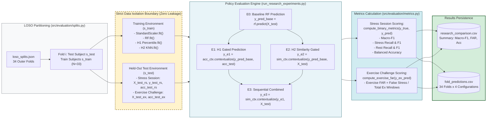
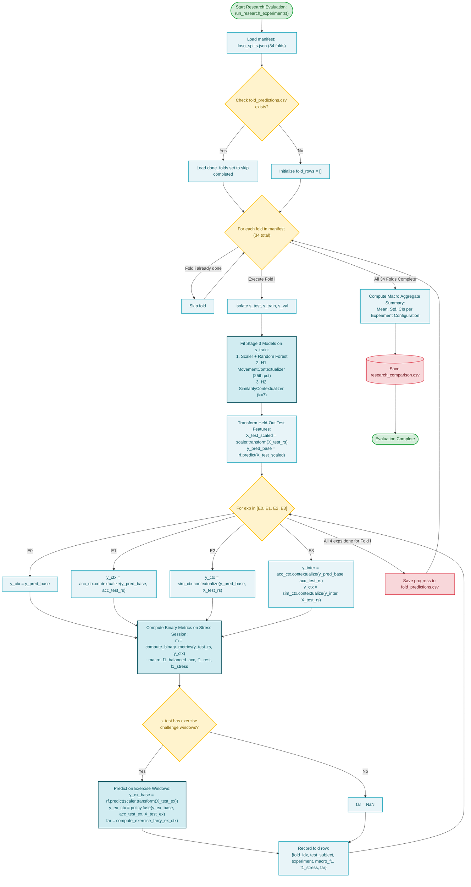

# Stage 4: Model Evaluation & Validation

**COEN 6322: AI for Wearable Health Applications, Fall 2026**

---

## 1. Stage Scope & Responsibilities

Stage 4 conducts the scientific validation of all model configurations under subject-disjoint partitions. It enforces zero data leakage between development and evaluation participants, computes multi-class classification and false-alarm metrics, and saves reproducible benchmarks.

### Primary Modules
- [`src/evaluation/splits.py`](file:///Users/fernando/Concordia/2026_2_Fall/COEN_6322/project/code/src/evaluation/splits.py): Partition manifest generator for outer LOSO and inner grouped validation.
- [`src/evaluation/metrics.py`](file:///Users/fernando/Concordia/2026_2_Fall/COEN_6322/project/code/src/evaluation/metrics.py): Binary classification metrics, clustered bootstrap confidence intervals, and Exercise False Alarm Rate (FAR).
- [`src/research/run_research_experiments.py`](file:///Users/fernando/Concordia/2026_2_Fall/COEN_6322/project/code/src/research/run_research_experiments.py): 34-fold nested evaluation runner for configurations E0–E3.
- [`src/experiments/run_experiments.py`](file:///Users/fernando/Concordia/2026_2_Fall/COEN_6322/project/code/src/experiments/run_experiments.py): Historical 3×3 factorial runner (Majority, RF, 1D-CNN across EDA, PPG, Fusion).

---

## 2. Experimental Configurations (E0–E3)

All research configurations evaluate the best-performing multimodal physiological feature representation (EDA + PPG, 20 features) under Leave-One-Subject-Out:

- **E0 (Baseline Random Forest):** Uncontextualized RF predictions.
- **E1 (RF + H1 Movement Gate):** Dynamic acceleration gating. If primary RF predicts STRESS (1) and `DYNAMIC_SVM_MEAN` $\ge \tau_{\text{motion}}$, the prediction is overridden to REST (0).
- **E2 (RF + H2 Physiological Similarity):** Non-parametric $k$-NN retrieval ($k=7$). If primary RF predicts STRESS (1) and exercise neighbor fraction $\ge 0.40$, the prediction is overridden to REST (0).
- **E3 (Combined H1 + H2):** Sequential fusion. H1 motion gate is applied first; remaining STRESS predictions are subsequently screened by H2 similarity.

---

## 3. Verified Empirical Benchmark Results (34-Fold LOSO)

From [`data/results/research/comparison/research_comparison.csv`](file:///Users/fernando/Concordia/2026_2_Fall/COEN_6322/project/data/results/research/comparison/research_comparison.csv):

| Config | Description | Macro-F1 (Mean ± SD) | Balanced Acc | Rest F1 | Stress F1 | Exercise FAR |
|:---:|:---|:---:|:---:|:---:|:---:|:---:|
| **E0** | Baseline Random Forest | 0.6481 ± 0.1570 | 68.94% | 0.8303 | 0.4660 | **61.58%** |
| **E1** | **RF + H1 ACC-aware movement gate** | **0.6528 ± 0.1528** | **68.81%** | **0.8430** | **0.4627** | **15.58%** |
| **E2** | RF + H2 KNN physiological similarity | 0.5226 ± 0.0849 | 54.18% | 0.8669 | 0.1784 | **2.79%** |
| **E3** | RF + H1 + H2 (Combined) | 0.5228 ± 0.0848 | 54.21% | 0.8671 | 0.1785 | **0.98%** |

### Nuanced Pareto Analysis
- **H1 Performance Trade-off:** H1 provides an extraordinary **74.7% relative reduction** in Exercise FAR (from 61.58% down to 15.58%) while increasing overall Macro-F1 (0.6481 to 0.6528) and Rest F1 (0.8303 to 0.8430). However, it is not strictly Pareto-dominant across every single metric: Stress F1 exhibits a slight decline (0.4660 to 0.4627) and Balanced Accuracy drops by 0.13% (68.94% to 68.81%) due to occasional small wrist gestures during cognitive tasks tripping the 25th percentile gate.
- **H2 Autonomic Overlap:** H2 demonstrates that physiological similarity alone can reduce false alarms to 2.79%, but because sympathetic hyperarousal during exercise mimics cognitive stress, it over-suppresses true stress alarms, lowering Stress F1 to 0.1784.

---

## 4. Stage 4 Block Diagram

---

## 5. Stage 4 Execution Flowchart

