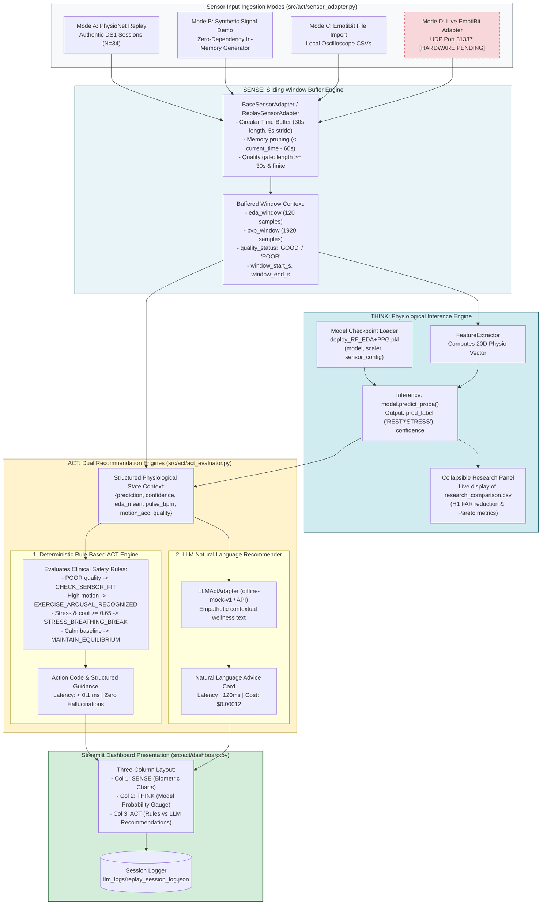

# Stage 5: Model Inference & Application

**COEN 6322: AI for Wearable Health Applications, Fall 2026**

---

## 1. Stage Scope & Responsibilities

Stage 5 delivers the real-time Sense–Think–Act demonstration framework implemented in Streamlit ([`src/act/dashboard.py`](file:///Users/fernando/Concordia/2026_2_Fall/COEN_6322/project/code/src/act/dashboard.py)). It ingests continuous biometric samples, buffers sliding 30-second temporal windows, executes model inference from serialized checkpoints, and generates comparative adaptive recommendations through dual rule-based and LLM actuation engines.

### Primary Modules
- [`src/act/dashboard.py`](file:///Users/fernando/Concordia/2026_2_Fall/COEN_6322/project/code/src/act/dashboard.py): Interactive Streamlit application interface.
- [`src/act/sensor_adapter.py`](file:///Users/fernando/Concordia/2026_2_Fall/COEN_6322/project/code/src/act/sensor_adapter.py): Time-indexed circular buffer managing sliding 30s temporal windows with automatic memory pruning.
- [`src/act/act_evaluator.py`](file:///Users/fernando/Concordia/2026_2_Fall/COEN_6322/project/code/src/act/act_evaluator.py): Dual actuation engines (`DeterministicRuleAct` and `LLMActAdapter`).
- [`src/act/run_act_eval.py`](file:///Users/fernando/Concordia/2026_2_Fall/COEN_6322/project/code/src/act/run_act_eval.py): 6-dimension scientific rubric evaluator.

---

## 2. Ingestion Modes & Hardware Disclosure

The dashboard provides four selectable ingestion pathways:

1. **Mode A — PhysioNet Recorded Replay:** Chronological step-by-step playback of authentic PhysioNet DS1 sessions across all 34 paired subjects (REST, STRESS, AEROBIC, ANAEROBIC).
2. **Mode B — Synthetic Signal Demo:** Mathematical biometric waveform generator (zero dataset dependency) simulating acute stress tachycardia and resting equilibrium.
3. **Mode C — EmotiBit File Import:** Local CSV ingestion parser for recorded personal EmotiBit sessions.
4. **Mode D — Live EmotiBit UDP Broadcast [HARDWARE PENDING]:** Socket interface on UDP port 31337 architected in code for EmotiBit data packets. **Disclosed Status:** Unverified with live physical hardware on body; marked as pending hardware commissioning.

---

## 3. The Sense–Think–Act Architecture

### 1. SENSE (Sensor Adapter Buffer)
- Continuous samples are pushed into circular lists `(timestamp_s, value)` for EDA and BVP.
- Samples older than `current_time - 60.0s` are aggressively pruned to maintain bounded memory footprint.
- Extracts current 30-second slice (`curr_time - 30.0s` to `curr_time`).
- Validates data sufficiency and flags `quality_status` ("GOOD" vs. "POOR").

### 2. THINK (Inference & Gating)
- Loads pre-trained model checkpoint (`deploy_RF_EDA+PPG.pkl`).
- Computes 20-dimensional feature vector in real time.
- Standardizes using the deployment scaler and calculates posterior class probabilities (`model.predict_proba()`).
- Renders real-time stress probability gauge and classification state.
- Features an expandable research panel exposing empirical 34-fold LOSO metrics from `research_comparison.csv`.

### 3. ACT (Adaptive Recommendations)
- **Deterministic Rules (`DeterministicRuleAct`):**
  - Latency: $< 0.1\,\text{ms}$.
  - Guarantees zero hallucinations and adheres to non-diagnostic wellness framing.
  - Action codes: `CHECK_SENSOR_FIT`, `EXERCISE_AROUSAL_RECOGNIZED`, `STEADY_EXERCISE`, `STRESS_BREATHING_BREAK`, `MAINTAIN_EQUILIBRIUM`.
- **LLM Recommender (`LLMActAdapter`):**
  - Generates empathetic natural language advice (`offline-mock-v1` or external API).
  - Tracks token usage, monetary cost, and response latency.
  - Step logs are serializable to `llm_logs/replay_session_log.json`.

---

## 4. Stage 5 Block Diagram

---

## 5. Stage 5 Execution Flowchart

```mermaid
flowchart TD
    START(["Start Dashboard: streamlit run src/act/dashboard.py"]):::terminator --> LOAD_RESOURCES["Load Cached Resources via @st.cache_resource:<br/>- SignalLoader<br/>- FeatureExtractor<br/>- TensorBuilder"]:::process

    LOAD_RESOURCES --> SIDEBAR["Sidebar User Configuration:<br/>1. Mode: PhysioNet (A) / Synthetic (B) / EmotiBit (C/D)<br/>2. Subject & Session Type<br/>3. Model: RandomForest / 1D-CNN / Majority<br/>4. Sensor Set: EDA+PPG / EDA / PPG<br/>5. Replay Stride (seconds)"]:::process

    SIDEBAR --> INIT_ADAPTER{"Adapter in st.session_state?"}:::decision
    INIT_ADAPTER -->|"No / Key Changed"| CREATE_ADAPTER["Instantiate ReplaySensorAdapter(window_len=30s, step=stride)"]:::process
    INIT_ADAPTER -->|"Yes"| REUSE_ADAPTER["Retrieve active adapter instance"]:::process

    CREATE_ADAPTER & REUSE_ADAPTER --> BTN_STEP{"User clicks 'Step Forward' or 'Auto Replay'?"}:::decision
    BTN_STEP -->|"Step Forward"| ADVANCE_BUFFER["Advance time by stride seconds:<br/>adapter.advance_by_step()<br/>Push new biometric samples into buffer"]:::subproc

    ADVANCE_BUFFER --> CHECK_BUF{"adapter.has_sufficient_data()?<br/>(Span >= 30 seconds)"}:::decision
    CHECK_BUF -->|"No"| DISP_WAIT["Display: 'Awaiting sufficient sensor window buffer...'"]:::process
    CHECK_BUF -->|"Yes"| GET_WIN["latest_win = adapter.get_latest_window()"]:::process

    GET_WIN --> COL_SENSE["Render Column 1 (SENSE):<br/>Plot real-time EDA (4Hz) & BVP (64Hz) waveforms"]:::output

    GET_WIN --> COL_THINK["Execute Column 2 (THINK):<br/>1. Extract 20D feature vector<br/>2. Load deploy_RF_EDA+PPG.pkl<br/>3. Run model.predict_proba(scaler.transform(X))<br/>4. Determine pred_label ('STRESS' vs 'REST')<br/>5. Render Probability Gauge"]:::subproc

    COL_THINK --> BUILD_CTX["Construct Action Context:<br/>{prediction, confidence, eda_mean, pulse_bpm, motion_acc, quality}"]:::process

    BUILD_CTX --> COL_ACT["Execute Column 3 (ACT):<br/>1. DeterministicRuleAct.generate_recommendation()<br/>   -> Outputs Action Code & Guidance (< 0.1ms)<br/>2. LLMActAdapter.generate_recommendation()<br/>   -> Outputs Natural Language Text"]:::subproc

    COL_ACT --> LOG_BTN{"User clicks 'Save Anonymized Step Log'?"}:::decision
    LOG_BTN -->|"Yes"| WRITE_LOG[("Append entry to:<br/>llm_logs/replay_session_log.json")]:::storage
    LOG_BTN -->|"No"| RENDER_RESEARCH["Render Collapsible Research Expander:<br/>Display empirical metrics from research_comparison.csv"]:::output

    WRITE_LOG --> RENDER_RESEARCH
    RENDER_RESEARCH --> WAIT_NEXT(["Idle: Await next user interaction"]):::terminator

    classDef terminator fill:#d4edda,stroke:#28a745,stroke-width:2px,color:#155724;
    classDef process fill:#e8f4f8,stroke:#17a2b8,stroke-width:1.5px,color:#0c5460;
    classDef subproc fill:#d1ecf1,stroke:#0c5460,stroke-width:2px,color:#0c5460;
    classDef decision fill:#fff3cd,stroke:#ffc107,stroke-width:2px,color:#856404;
    classDef storage fill:#f8d7da,stroke:#dc3545,stroke-width:1.5px,color:#721c24;
    classDef output fill:#e2e3e5,stroke:#383d41,stroke-width:1.5px,color:#383d41;
```

