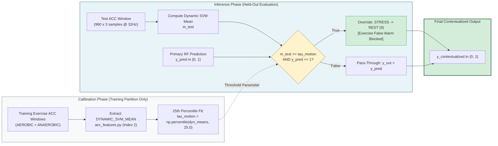
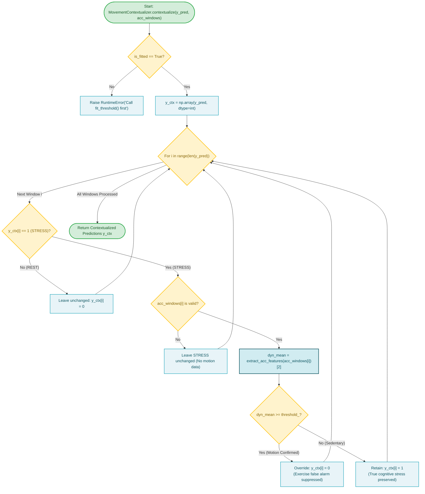

# Subsystem 4: ACC-Aware Contextualization (Hypothesis 1)

**COEN 6322: AI for Wearable Health Applications, Fall 2026**

---

## 1. Scientific Hypothesis & Problem Formulation

### The Problem
Autonomic physiological models (EDA + PPG) suffer from severe false alarms during physical exercise (~61.6% false stress alarms on PhysioNet challenge data). Physical movement triggers sympathetic nervous system excitation, causing heart rate elevation, heart rate variability depression, and increased sweat gland conductance identical to acute psychological threat.

### Hypothesis 1 (H1)
Tri-axial wrist accelerometry ($f_s = 32\text{ Hz}$) provides direct kinetic evidence of gross physical activity. If an autonomic window is classified as STRESS (1), but concurrent wrist motion intensity exceeds a calibrated threshold, the prediction can be safely overridden to REST (0).

---

## 2. Mathematical Formulation & Algorithmic Design

Implemented in [`src/research/acc_aware/movement_context.py`](file:///Users/fernando/Concordia/2026_2_Fall/COEN_6322/project/code/src/research/acc_aware/movement_context.py) (`MovementContextualizer`):

### 1. Motion Intensity Metric
From tri-axial acceleration $[x_t, y_t, z_t]$:
1. Signal Vector Magnitude: $SVM_t = \sqrt{x_t^2 + y_t^2 + z_t^2}$.
2. Dynamic Acceleration: $d_t = SVM_t - (SVM * \mathbf{1}_{32}/32)_t$.
3. Feature: $m = \frac{1}{N} \sum_{t=1}^N |d_t|$ (`DYNAMIC_SVM_MEAN`).

### 2. Threshold Calibration (Training Time)
To prevent hand-tuning and eliminate data leakage, the threshold $\tau_{\text{motion}}$ is fitted dynamically per fold strictly on the training subjects' exercise sessions:
$$\tau_{\text{motion}} = \text{Percentile}_{25}\left(\left\{m_j\right\}_{j \in \text{TrainExerciseWindows}}\right)$$
Choosing the **25th percentile** ensures the gate activates for 75% of vigorous exercise patterns while remaining high enough to avoid false triggers during sedentary desk work or small wrist fidgets.

### 3. Contextualization Rule (Inference Time)
For primary model prediction $\hat{y}_i \in \{0, 1\}$ and ACC window $W_{\text{acc}, i}$:
$$\hat{y}_{i, \text{H1}} = \begin{cases} 
0, & \text{if } \hat{y}_i = 1 \text{ and } \text{DYNAMIC\_SVM\_MEAN}(W_{\text{acc}, i}) \ge \tau_{\text{motion}} \\
\hat{y}_i, & \text{otherwise}
\end{cases}$$
**Safety Property:** The gate only overrides STRESS $\to$ REST; it never flips REST $\to$ STRESS.

---

## 3. Subsystem Block Diagram

---

## 4. Subsystem Execution Flowchart

