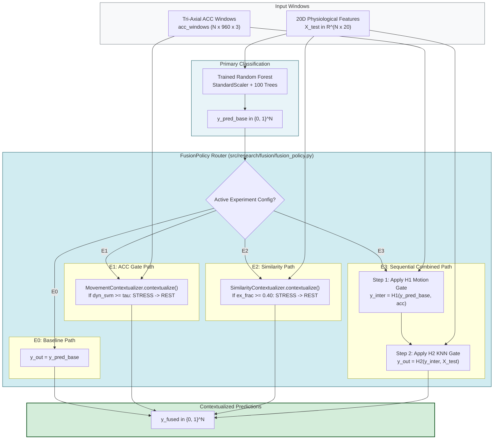
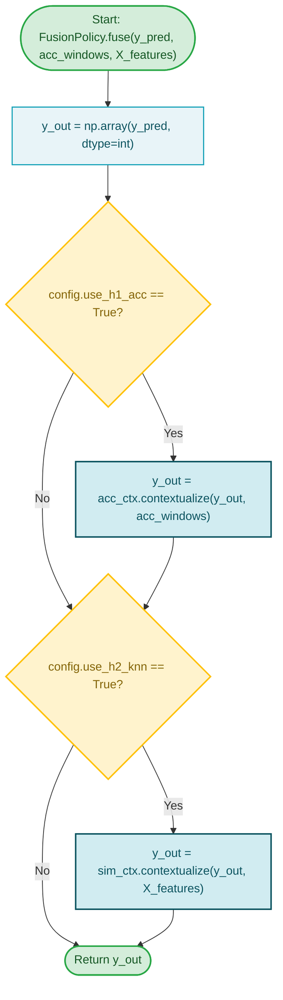

# Subsystem 6: Decision Fusion Policies (E0–E3)

**COEN 6322: AI for Wearable Health Applications, Fall 2026**

---

## 1. Specification of the Combinatorial Matrix

The decision fusion engine ([`src/research/fusion/fusion_policy.py`](file:///Users/fernando/Concordia/2026_2_Fall/COEN_6322/project/code/src/research/fusion/fusion_policy.py)) orchestrates the interaction between the primary statistical Random Forest classifier and the two contextualization mechanisms (H1 Motion Gating and H2 Exemplar Retrieval).

| Experiment Configuration | ACC Motion Gate (H1) | Physiological k-NN (H2) | Primary Hypothesis Under Test |
|:---:|:---:|:---:|:---|
| **E0** | Disabled | Disabled | **Baseline:** Can autonomic features alone (EDA + PPG) separate cognitive stress from physical exercise without context? |
| **E1** | **Enabled** | Disabled | **H1:** Does wrist kinematic evidence suppress false alarms during physical exercise without degrading cognitive stress recall? |
| **E2** | Disabled | **Enabled** | **H2:** Can non-parametric neighborhood voting in 20D autonomic space identify exercise confounding without motion sensors? |
| **E3** | **Enabled** | **Enabled** | **Combined:** Does sequential multimodal fusion provide complementary artifact rejection? |

---

## 2. Sequential Execution Order in E3

When both contextualizers are active (`E3`):
1. **Stage 1 — Kinematic Motion Screening (H1):** Fast, rule-based check on tri-axial accelerometry. Any prediction where `DYNAMIC_SVM_MEAN` $\ge \tau_{\text{motion}}$ is immediately overridden from STRESS (1) to REST (0).
2. **Stage 2 — Autonomic Similarity Screening (H2):** The surviving STRESS predictions are queried against the exact $k$-NN index in 20D feature space. If the neighborhood exercise fraction $\ge 0.40$, the prediction is overridden to REST (0).

---

## 3. Subsystem Block Diagram

---

## 4. Subsystem Execution Flowchart

