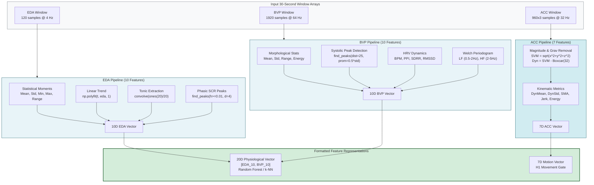
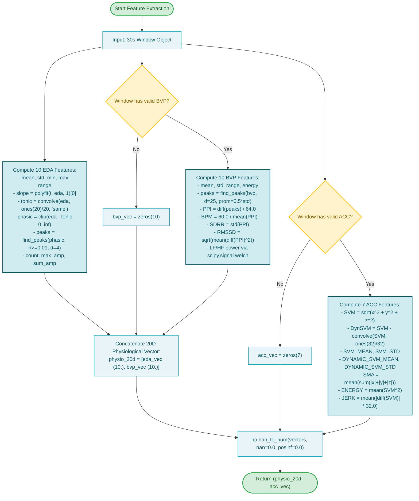

# Subsystem 2: Feature Extraction Pipeline

**COEN 6322: AI for Wearable Health Applications, Fall 2026**

---

## 1. Algorithmic Formulations

The feature extraction pipeline converts continuous 30-second physiological and motion waveforms into compact, noise-tolerant feature vectors.

### EDA Feature Extraction (`extract_eda_features`)
Inputs: 30-second EDA window (120 samples at 4 Hz).
1. **Moments (Mean, Std, Min, Max, Range):** Standard empirical statistical moments capturing baseline level and variance.
2. **Linear Drift Slope:** $\beta_1$ calculated by fitting a 1st-degree polynomial $x_t = \beta_1 t + \beta_0$ across the 120 time indices using `np.polyfit`.
3. **Tonic Conductance:** Moving average over 5.0 seconds (kernel length $K = 20$ samples):
   $$\text{Tonic}_t = \frac{1}{K} \sum_{j=-K/2}^{K/2} \text{EDA}_{t+j}$$
4. **Phasic SCR Peak Count & Amplitudes:** Phasic signal isolated by $\max(0, \text{EDA} - \text{Tonic})$. Peaks detected via `scipy.signal.find_peaks` with parameters:
   - Minimum height: $0.01\,\mu\text{S}$.
   - Minimum temporal distance: $1.0\,\text{s}$ (4 samples).
   - Metrics extracted: Total peak count, maximum peak amplitude, and cumulative sum of peak amplitudes.

### BVP/PPG Feature Extraction (`extract_bvp_features`)
Inputs: 30-second BVP window (1920 samples at 64 Hz).
1. **Moments & Energy:** Mean, standard deviation, peak-to-peak range, and mean squared signal energy $\frac{1}{N}\sum y_i^2$.
2. **Systolic Peak Detection & Heart Rate:** Peaks located using `scipy.signal.find_peaks` with:
   - Minimum distance: $0.4\,\text{s}$ (25 samples at 64 Hz, enforcing a physiological ceiling of $150\,\text{BPM}$).
   - Prominence threshold: $0.5 \times \sigma_{\text{BVP}}$.
3. **Peak-to-Peak Intervals (PPI) & Heart Rate Variability:**
   - Interval vector in seconds: $\text{PPI}_k = \frac{\text{peak}_{k+1} - \text{peak}_k}{64.0}$.
   - Pulse rate: $\text{BPM} = 60.0 / \overline{\text{PPI}}$.
   - SDRR (standard deviation of intervals): $\sigma_{\text{PPI}}$.
   - RMSSD: Root mean square of successive interval differences:
     $$\text{RMSSD} = \sqrt{\frac{1}{K-1} \sum_{k=1}^{K-1} (\text{PPI}_{k+1} - \text{PPI}_k)^2}$$
4. **Spectral Power (Welch Periodogram):** Welch PSD computed with Hamming window segment length $8.0\,\text{s}$ (512 samples). Low-frequency power integrated across $0.5 - 2.0\,\text{Hz}$; high-frequency power across $2.0 - 5.0\,\text{Hz}$.

### Accelerometer Feature Extraction (`extract_acc_features`)
Inputs: 30-second ACC window ($960 \times 3$ samples at 32 Hz).
1. Total acceleration magnitude: $SVM_i = \sqrt{x_i^2 + y_i^2 + z_i^2}$.
2. Dynamic acceleration: $SVM_i - \text{Convolve}(SVM, \mathbf{1}_{32}/32)_i$.
3. 7 Kinematic features: `SVM_MEAN`, `SVM_STD`, `DYNAMIC_SVM_MEAN`, `DYNAMIC_SVM_STD`, `SMA`, `ENERGY`, `JERK_MEAN`.

---

## 2. Subsystem Block Diagram

---

## 3. Subsystem Execution Flowchart

