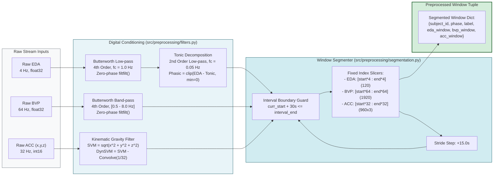
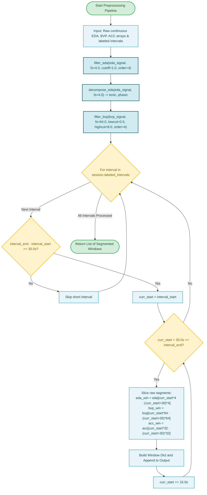

# Subsystem 1: Multisensor Preprocessing

**COEN 6322: AI for Wearable Health Applications, Fall 2026**

---

## 1. Technical Specification & Signal Conditioning

The preprocessing subsystem ingests three heterogeneous asynchronous sensor streams from the Empatica E4 wristband and prepares clean, boundary-safe 30-second windows.

### Digital Filtering Specifications
1. **Electrodermal Activity (EDA, 4 Hz):**
   - **Primary Low-Pass Filter:** 4th-order zero-phase Butterworth filter with cutoff $f_c = 1.0\text{ Hz}$ (`scipy.signal.filtfilt(b, a, eda_signal)`). Removes high-frequency electrical interference while preserving sudomotor nerve impulses ($0.05 - 0.5\text{ Hz}$).
   - **Tonic/Phasic Decomposition:** 2nd-order low-pass filter with cutoff $f_c = 0.05\text{ Hz}$ extracts slowly varying tonic Skin Conductance Level (SCL). The phasic Skin Conductance Response (SCR) is obtained via subtraction:
     $$\text{Phasic}(t) = \max\left(0, \text{EDA}_{\text{filtered}}(t) - \text{Tonic}(t)\right)$$
2. **Photoplethysmography (BVP, 64 Hz):**
   - **Band-Pass Filter:** 4th-order zero-phase Butterworth filter with passband $[0.5\text{ Hz}, 8.0\text{ Hz}]$. Lower cutoff ($0.5\text{ Hz}$, corresponding to $30\text{ BPM}$) suppresses baseline respiratory wander; upper cutoff ($8.0\text{ Hz}$, corresponding to $480\text{ BPM}$) eliminates high-frequency sensor motion jitter while preserving dicrotic notches.
3. **Tri-Axial Accelerometer (ACC, 32 Hz):**
   - **Signal Vector Magnitude:** $SVM(t) = \sqrt{x(t)^2 + y(t)^2 + z(t)^2}$.
   - **Gravity Removal:** 1-second rolling boxcar average (32 samples) captures the static gravitational acceleration vector ($\sim 64$ units in E4 scale):
     $$\text{Dynamic } SVM(t) = SVM(t) - (SVM * \mathbf{1}_{32}/32)(t)$$

---

## 2. Window Segmentation Algorithm

Implemented in `src/preprocessing/segmentation.py` (`WindowSegmenter`):
- **Window Length:** $T_{\text{win}} = 30.0\text{ s}$ (120 EDA samples, 1920 BVP samples, 960 ACC samples).
- **Temporal Stride:** $T_{\text{stride}} = 15.0\text{ s}$ ($50\%$ overlap).
- **Boundary Safety Constraint:** Slicing is constrained strictly within each protocol interval $[t_{\text{start}}, t_{\text{end}}]$. If $t_{\text{curr}} + 30.0\text{ s} > t_{\text{end}}$, the loop terminates immediately for that phase. Windows never cross protocol phases or participant sessions.

---

## 3. Subsystem Block Diagram

---

## 4. Subsystem Execution Flowchart

