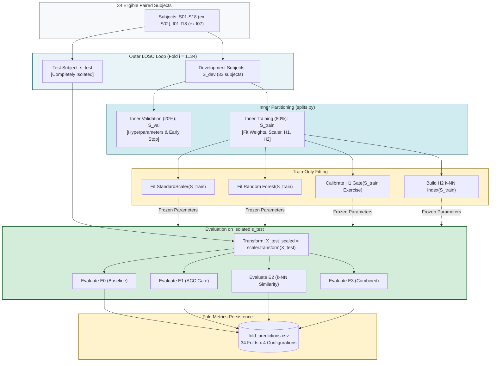
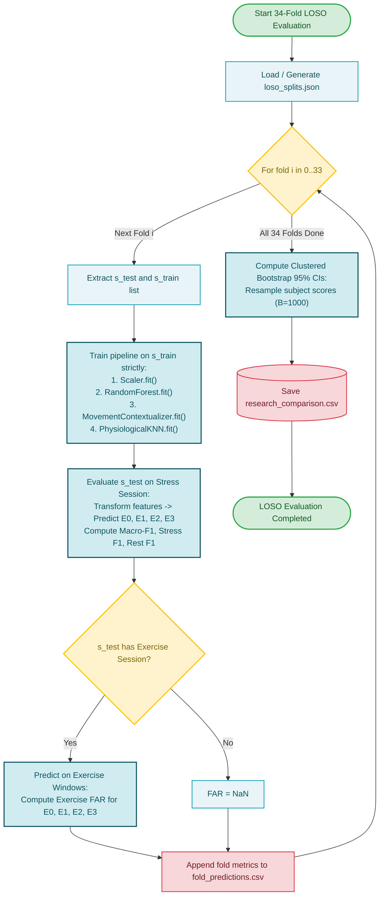

# Subsystem 7: Nested Subject-Disjoint LOSO Evaluation

**COEN 6322: AI for Wearable Health Applications, Fall 2026**

---

## 1. Zero Data-Leakage Protocol

In physiological machine learning, random window-level cross-validation leads to severe optimistic bias because neighboring sliding windows from the same subject share baseline physiological morphology. The evaluation subsystem implements a strict **Nested Leave-One-Subject-Out (LOSO)** cross-validation strategy:

1. **Outer Loop (34 Folds):**
   - In each fold $i \in \{1, \dots, 34\}$, exactly one subject $s_{\text{test}}$ is held out exclusively for test scoring.
   - The remaining 33 participants form the development cohort $\mathcal{S}_{\text{dev}}$.
2. **Inner Loop (Zero-Leakage Model Selection):**
   - For hyperparameter tuning and early stopping (1D-CNN), 20% of $\mathcal{S}_{\text{dev}}$ is reserved as an inner validation cohort $\mathcal{S}_{\text{val}}$, while the remainder $\mathcal{S}_{\text{train}}$ trains the weights.
3. **Strict Normalization Isolation:**
   - All standardizers (`sklearn.preprocessing.StandardScaler`) are fit strictly on $\mathcal{S}_{\text{train}}$. The held-out test subject is transformed using frozen parameters:
     $$X_{\text{test, scaled}} = \frac{X_{\text{test}} - \mu_{\text{train}}}{\sigma_{\text{train}}}$$
4. **Contextualization Isolation:**
   - The motion threshold $\tau_{\text{motion}}$ is computed strictly from $\mathcal{S}_{\text{train}}$ exercise sessions.
   - The $k$-NN reference index is populated strictly from $\mathcal{S}_{\text{train}}$ feature vectors.

---

## 2. Statistical Confidence Estimation

Implemented in [`src/evaluation/metrics.py`](file:///Users/fernando/Concordia/2026_2_Fall/COEN_6322/project/code/src/evaluation/metrics.py):
- **Subject-Clustered Bootstrap:** Rather than resampling individual windows (which violates independence), the bootstrap resamples entire subject-level Macro-F1 scores with replacement ($B = 1000$ iterations) to construct 95% confidence intervals:
  $$\text{CI}_{95\%} = [\text{Percentile}_{2.5}(\{\bar{\theta}_b\}), \text{Percentile}_{97.5}(\{\bar{\theta}_b\})]$$

---

## 3. Subsystem Block Diagram

---

## 4. Subsystem Execution Flowchart

