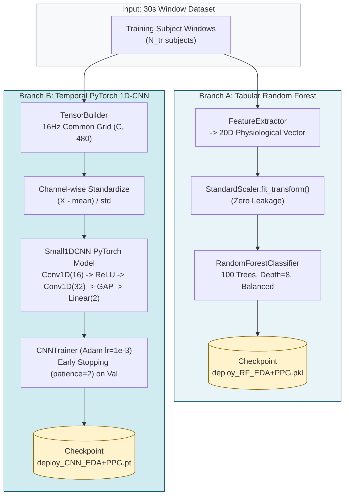
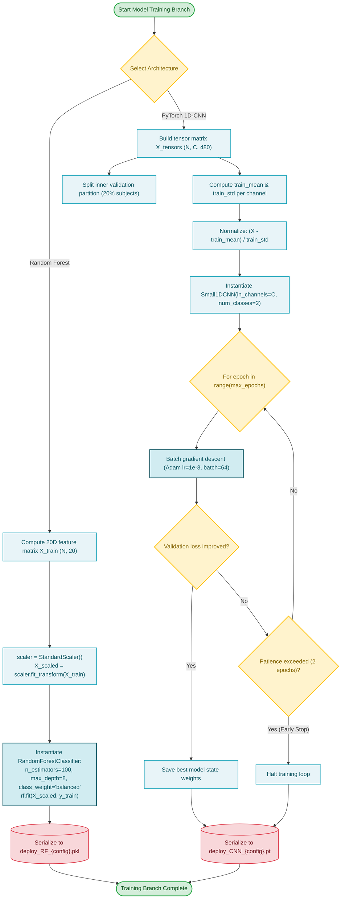

# Subsystem 3: Random Forest & CNN Training Branches

**COEN 6322: AI for Wearable Health Applications, Fall 2026**

---

## 1. Architectural Divergence: Tabular vs. Temporal

The project benchmarks two fundamentally distinct machine learning paradigms on wearable physiological signals:

1. **Tabular Feature-Engineered Branch (Random Forest):**
   - **Inductive Bias:** Uses domain-guided statistical moments and physiological peak intervals (20 features).
   - **Invariance:** Highly invariant to phase shifts, sensor baseline drifts, and minor temporal misalignments.
   - **Empirical Performance:** Consistently outperforms raw neural architectures on small cohorts ($N=34$), achieving **Macro-F1 = 0.6528** vs. 0.4782 for 1D-CNN.
2. **End-to-End Temporal Waveform Branch (1D-CNN):**
   - **Inductive Bias:** Hierarchical 1D convolutional kernel feature extractors operating directly on resampled waveforms ($(C \times 480)$ at 16 Hz).
   - **Risk on Small Cohorts:** Prone to overfitting on idiosyncratic subject morphologies despite aggressive regularization and early stopping.

---

## 2. Model Specifications

### Random Forest (`src/models/random_forest.py`)
```python
RandomForestClassifier(
    n_estimators=100,
    max_depth=8,
    min_samples_split=4,
    class_weight="balanced",
    random_state=seed,
    n_jobs=-1
)
```
- Integrated with `sklearn.preprocessing.StandardScaler` fitted strictly on training fold vectors.
- Saved deployment artifact (`deploy_RF_EDA+PPG.pkl`) dictionary structure:
  ```python
  {
      "model": rf_model,
      "scaler": scaler,
      "sensor_config": "EDA+PPG",
      "features_dim": 20
  }
  ```

### PyTorch 1D-CNN (`src/models/cnn1d.py`)
- **Layer 1:** `Conv1D(in_channels=C, out_channels=16, kernel_size=7, stride=2, padding=3)` + `ReLU()`.
- **Layer 2:** `Conv1D(in_channels=16, out_channels=32, kernel_size=5, stride=2, padding=2)` + `ReLU()`.
- **Global Average Pooling:** `GAP1D` reducing temporal dimension $120 \to 1$.
- **Classifier:** `Linear(in_features=32, out_features=2)` with Cross-Entropy Loss.
- **Training Harness (`CNNTrainer`):** Adam optimizer ($\text{lr} = 10^{-3}$), batch size 64, maximum 6 epochs, early stopping patience 2 evaluated on inner validation partition.

---

## 3. Subsystem Block Diagram



---

## 4. Subsystem Execution Flowchart


