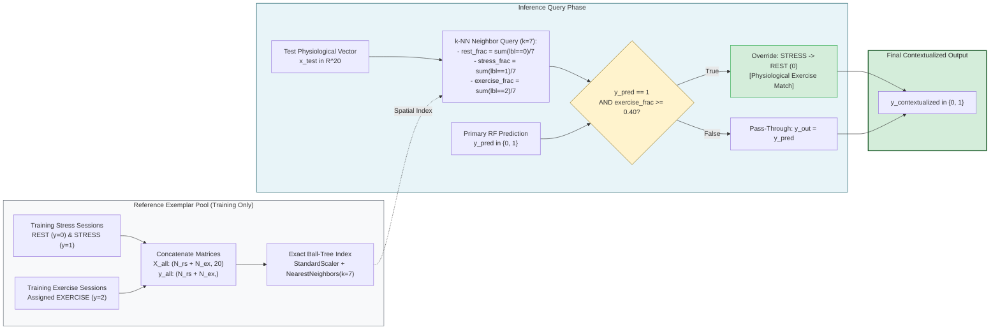
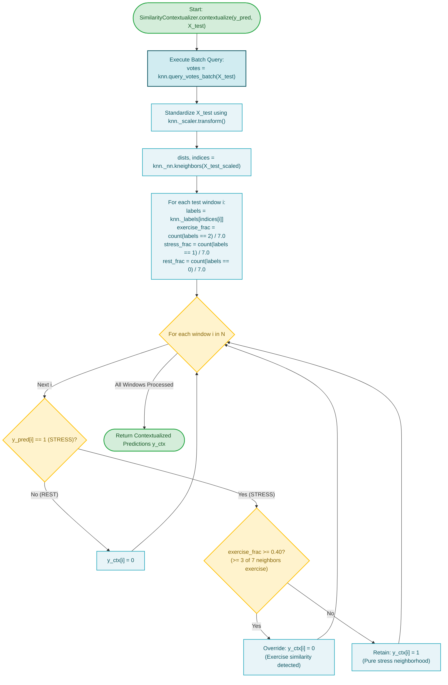

# Subsystem 5: Similarity-Aware Contextualization (Hypothesis 2)

**COEN 6322: AI for Wearable Health Applications, Fall 2026**

---

## 1. Scientific Hypothesis & Formulation

### Hypothesis 2 (H2)
Can non-parametric physiological exemplar retrieval detect physical exercise confounding *without* requiring an accelerometer?

If a 20-dimensional autonomic feature vector (EDA + PPG) is ambiguous to a parametric Random Forest boundary, querying an exact $k$-Nearest-Neighbors index populated with historical exemplars of verified REST (0), STRESS (1), and EXERCISE (2) provides non-parametric voting evidence of the physiological neighborhood.

---

## 2. Mathematical Formulation & Algorithmic Design

Implemented in [`src/research/similarity_aware/knn_retrieval.py`](file:///Users/fernando/Concordia/2026_2_Fall/COEN_6322/project/code/src/research/similarity_aware/knn_retrieval.py) (`PhysiologicalKNN`) and [`src/research/similarity_aware/similarity_context.py`](file:///Users/fernando/Concordia/2026_2_Fall/COEN_6322/project/code/src/research/similarity_aware/similarity_context.py) (`SimilarityContextualizer`):

### 1. Exemplar Space Assembly (Training Time)
Given $N-1$ development subjects:
- Labeled Stress Session Vectors: $X_{\text{rs}} \in \mathbb{R}^{N_{\text{rs}} \times 20}$, $y_{\text{rs}} \in \{0, 1\}$.
- Labeled Exercise Session Vectors: $X_{\text{ex}} \in \mathbb{R}^{N_{\text{ex}} \times 20}$, $y_{\text{ex}} = 2$ (EXERCISE).
- Reference Index:
  $$X_{\text{all}} = \begin{bmatrix} X_{\text{rs}} \\ X_{\text{ex}} \end{bmatrix}, \quad y_{\text{all}} = \begin{bmatrix} y_{\text{rs}} \\ \mathbf{2}_{N_{\text{ex}}} \end{bmatrix}$$
- Indexing: Standardized via training scaler, stored in an exact spatial Ball-Tree:
  $$\text{Index} = \text{NearestNeighbors}(k=7, \text{metric}=\text{'euclidean'}, \text{algorithm}=\text{'ball\_tree'})$$

### 2. $k$-NN Voting Query
For candidate test feature vector $\mathbf{x}_{\text{test}} \in \mathbb{R}^{20}$:
1. Retrieve indices of $k=7$ nearest neighbors $\mathcal{N}_7(\mathbf{x}_{\text{test}})$.
2. Calculate empirical neighborhood fractions:
   $$f_{\text{ex}} = \frac{1}{7} \sum_{j \in \mathcal{N}_7} \mathbb{I}[y_j = 2], \quad f_{\text{stress}} = \frac{1}{7} \sum_{j \in \mathcal{N}_7} \mathbb{I}[y_j = 1], \quad f_{\text{rest}} = \frac{1}{7} \sum_{j \in \mathcal{N}_7} \mathbb{I}[y_j = 0]$$

### 3. Contextualization Override Rule
With default threshold $\theta_{\text{ex}} = 0.40$ ($\ge 3$ of 7 neighbors):
$$\hat{y}_{i, \text{H2}} = \begin{cases} 
0, & \text{if } \hat{y}_i = 1 \text{ and } f_{\text{ex}}(\mathbf{x}_i) \ge 0.40 \\
\hat{y}_i, & \text{otherwise}
\end{cases}$$

---

## 3. Empirical Trade-off & Autonomic Overlap

- **Exercise Alarm Suppression:** Drops Exercise FAR from 61.58% down to **2.79%** (E2).
- **The Over-Suppression Vulnerability:** Acute cognitive stress and vigorous exercise induce severe overlapping sympathetic responses (elevated heart rate, depressed RMSSD, elevated tonic conductance). Consequently, many true cognitive stress windows fall near exercise clusters in 20D space, causing Stress F1 to drop from 0.4660 to **0.1784**, and Macro-F1 to decline to **0.5226**.

---

## 4. Subsystem Block Diagram

---

## 5. Subsystem Execution Flowchart

