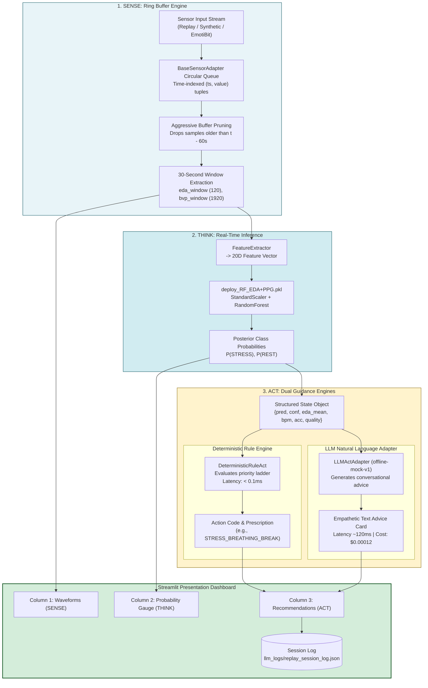
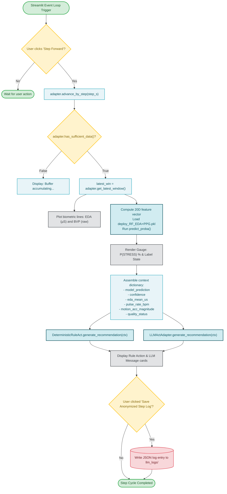

# Subsystem 8: Streamlit Sense–Think–Act Engine

**COEN 6322: AI for Wearable Health Applications, Fall 2026**

---

## 1. Architectural Concept: Closed-Loop Wearable Health

The Streamlit deployment dashboard ([`src/act/dashboard.py`](file:///Users/fernando/Concordia/2026_2_Fall/COEN_6322/project/code/src/act/dashboard.py)) implements an interactive closed-loop health prototype structured around the classic robotics **Sense–Think–Act** cycle:

1. **SENSE (Biometric Acquisition & Buffering):**
   - Continuously buffers incoming EDA and BVP streams in a time-indexed circular queue (`ReplaySensorAdapter`).
   - Extracts moving 30-second temporal windows with a configurable sliding stride (default 5.0 seconds).
   - Dynamically evaluates signal quality (e.g., checks sensor contact detachment or extreme values).
2. **THINK (Inference & State Estimation):**
   - Extracts the 20-dimensional physiological feature vector.
   - Loads the pre-trained deployment model (`deploy_RF_EDA+PPG.pkl`).
   - Outputs continuous stress probabilities and binary discrete states (`REST` vs. `STRESS`).
   - Surfaces empirical research metrics through a collapsible panel.
3. **ACT (Adaptive Contextual Intervention):**
   - Formulates a structured state dictionary:
     ```python
     context = {
         "model_prediction": 1,  # 0: REST, 1: STRESS
         "confidence": 0.82,
         "eda_mean_us": 4.15,
         "pulse_rate_bpm": 104.2,
         "motion_acc_magnitude": 1.05,
         "quality_status": "GOOD"
     }
     ```
   - Evaluates dual actuation engines:
     - **Deterministic Rules (`DeterministicRuleAct`):** $< 0.1\,\text{ms}$ latency, zero hallucinations, clinical wellness framing.
     - **LLM Natural Language Adapter (`LLMActAdapter`):** Generates empathetic personal advice with latency and cost tracking.

---

## 2. Subsystem Block Diagram



---

## 3. Subsystem Execution Flowchart


